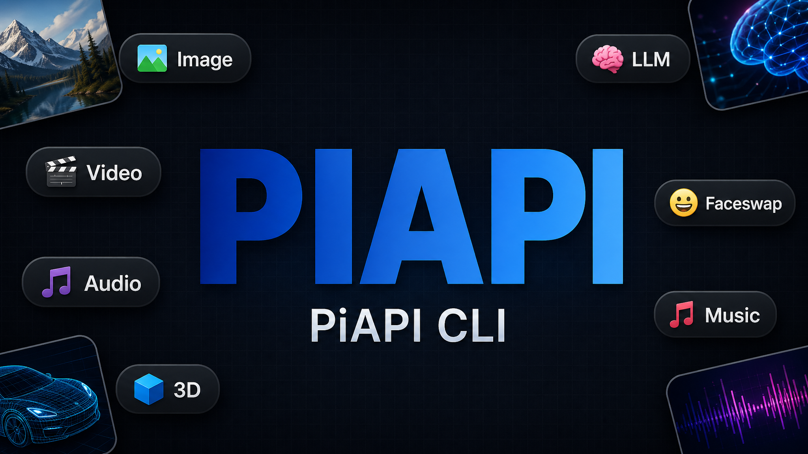
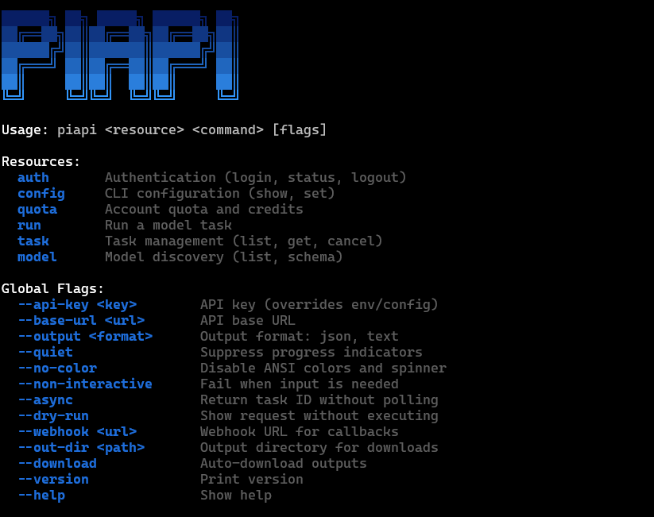

<p align="center">
  
</p>

<p align="center">
  <strong>piapi: one binary for 111 multimodal AI catalog entries</strong><br>
  Generate images, videos, audio, 3D, and chat with LLMs from your terminal or AI agent.
</p>

<p align="center">
  <a href="README_CN.md">中文文档</a> · <a href="https://piapi.ai">PiAPI</a> · <a href="https://piapi.ai/docs">Docs</a> · <a href="skill/SKILL.md">Agent Skill</a>
</p>

## Features

- **Image**: 32 entries including `flux-dev`, `nano-banana-pro`, `qwen-image-edit`, `seedream-5-pro`, GPT Image 2 GA and 2.5, plus image tools
- **Video**: 50 entries including `sora2-pro`, `kling-3`, `veo3-fast`, `seedance-2.5`, `seedance-2-mini`, and `minimax-h3`
- **Audio**: 11 entries including `mmaudio`, `seed-audio`, `f5-tts`, `diffrhythm`, `udio-music`, and `ace-step`
- **3D**: 6 entries including `trellis`, `trellis2`, `pixal3d`, `meshy`, `meshy-txt`, and `skin-tokens`
- **LLM**: 12 chat entries including `gpt-6-astra`, `gpt-5.6-sol`, `gpt-5.6-terra`, `gpt-5.6-luna`, and existing GPT, Claude and Gemini models
- **Streaming** — `--stream` for token-by-token LLM output; SSE-only models (`sora2-preview`) stream by default
- **File I/O**: `key=@./local.png` auto-uploads for unified tasks; GPT `--edit` sends local references directly as multipart. `--download` saves result URLs and synchronous or async image `b64_json` payloads
- **Two API surfaces**: unified tasks for media and OpenAI-compatible endpoints for chat and GPT image generation. `piapi model list` shows the bundled, documentation-verified catalog, not a live provider query.

See [the October 11, 2026 upstream update guide](docs/upstream-models.md) for new aliases and compatibility notes, and [GPT image workflows](docs/image-workflows.md) for synchronous editing and async generation/editing.

## Install

```bash
npm install -g piapi-cli      # npm
pnpm add -g piapi-cli         # pnpm
bun add -g piapi-cli          # bun
yarn global add piapi-cli     # yarn
```

Or run without installing:

```bash
npx piapi-cli@latest --help
```

Requires [Node.js](https://nodejs.org) 18+.

<p align="center">
  
</p>

## Quick Start

```bash
# Authenticate
piapi auth login --api-key sk-xxxxx

# Generate an image
piapi run flux-dev prompt="a corgi in space"
piapi run gpt-image-2 prompt="a corgi in space" size=1024x1024

# Chat with an LLM (token-by-token streaming)
piapi run gpt-4o prompt="explain async/await in JavaScript" --stream
piapi run claude-sonnet-4.6 prompt="rewrite this email more concisely" system="you are a writing coach"

# Generate a video (async), then wait for the result
piapi run sora2-pro prompt="ocean waves" --async
piapi task wait <task-id> --download

# Upload a local file → run → auto-download the result
piapi run remove-bg image=@./photo.png --download --out-dir ./out

# Check quota and browse the catalog
piapi quota
piapi model list --type video
```

## Commands

### piapi run \<model\> key=value...

Run any model with `key=value` inputs. Video and 3D unified models return
an async task ID by default, without requiring `--async`.
LLM and GPT image generation use synchronous OpenAI-compatible endpoints by default.
GPT image models also support `--edit` with local references and `--async` task submission.
Other media models use unified tasks, while Sora preview models stream.

```bash
piapi run flux-dev prompt="a corgi" aspect_ratio=16:9 num_outputs=4
piapi run kling-3 prompt="a sunset" duration=5
piapi run sora2-pro prompt="waves" --async
piapi run gpt-image-2 prompt="a robot" size=1024x1024
piapi run gpt-4o prompt="hello, world" --stream
piapi run flux-dev prompt="test" --dry-run
```

**Input operators** (httpie-style):

| Syntax | Meaning |
|---|---|
| `key=value` | Auto-coerced: `n=2` → number, `hd=true` → boolean, everything else string |
| `key==value` | Literal string, never coerced (`version==3.0` → `"3.0"`) |
| `key:=json` | Strict JSON: `urls:='["https://a.png","https://b.png"]'`, `cfg:='{"a":1}'` |

**Local files** — prefix any input with `@` to upload before the request runs:

```bash
piapi run remove-bg image=@./photo.png --download --out-dir ./out
piapi run faceswap source=@./face.jpg target=@./scene.png --async
```

Ephemeral upload requires a paid PiAPI plan. GPT `--edit image=@file` instead
sends the file directly as multipart, without ephemeral upload. `--download`
saves result URLs and GPT image base64, including `task wait` async results.
See [image workflow examples and limits](docs/image-workflows.md).

### piapi task

```bash
piapi task list
piapi task get <id>
piapi task wait <id> --download   # poll until finished, render like a sync run
piapi task cancel <id>   # provider-specific (Kling only); v1 returns a hint
```

### piapi model

```bash
piapi model list
piapi model list --type video
piapi model schema flux-dev
```

### piapi auth

```bash
piapi auth login --api-key sk-xxxxx
piapi auth status
piapi auth logout
```

> 💡 On shared machines, prefer `export PIAPI_API_KEY=sk-...` over `--api-key`.
> Command-line args are visible to other local users via `ps`.

### piapi config

```bash
piapi config show
piapi config set --key apiKey --value sk-xxxxx
```

### piapi quota

```bash
piapi quota
```

## Global Flags

| Flag | Description |
|---|---|
| `--api-key <key>` | API key (overrides env/config) |
| `--base-url <url>` | API base URL |
| `--output json` | JSON output on stdout |
| `--quiet` | Suppress progress indicators |
| `--non-interactive` | Fail on missing input |
| `--async` | Return task ID immediately |
| `--timeout <seconds>` | Max wait while polling a task (default 300) |
| `--stream` | Stream LLM output as it arrives (openai-completions only) |
| `--dry-run` | Preview request without executing |
| `--webhook <url>` | Webhook URL for callbacks |
| `--out-dir <path>` | Download directory |
| `--download` | Auto-download outputs |
| `--no-color` | Disable ANSI colors (also honours `NO_COLOR` env) |

## Configuration

Config lives at `~/.piapi/config.json`:

```json
{
  "apiKey": "sk-...",
  "baseUrl": "https://api.piapi.ai"
}
```

Precedence: CLI flags → environment variables → config file → defaults.

| Variable | Purpose |
|---|---|
| `PIAPI_API_KEY` | API key |
| `PIAPI_BASE_URL` | Override API base URL |
| `PIAPI_TIMEOUT_MS` | Override fetch timeout (default 120s synchronous images / 30s other API / 60s upload+download) |
| `PIAPI_NO_UPDATE_CHECK` | Disable the daily npm-version check |
| `NO_COLOR` | Disable ANSI colors (any truthy value) |

## AI Agent Integration

For Claude Code, Cursor, and other agents:

```bash
npx skills add PiAPI-1/piapi-cli
```

See [`skill/SKILL.md`](skill/SKILL.md) for the full agent skill specification.

## License

MIT
